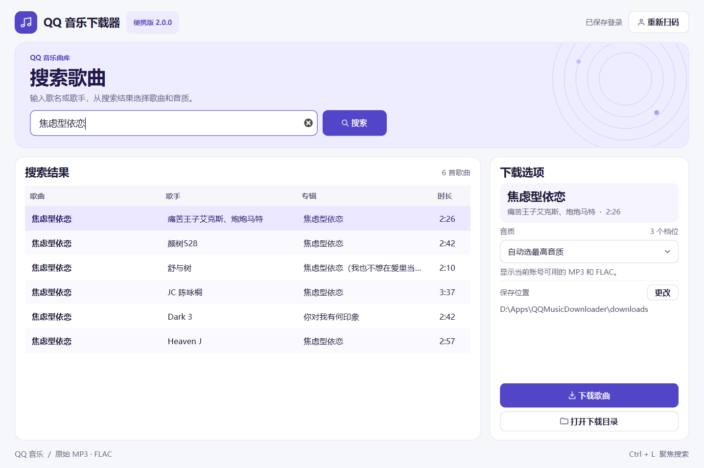

# QQ 音乐下载器

Windows x64 便携版 · `v2.0.0`

在桌面搜索 QQ 音乐，按歌手、专辑和时长选定歌曲版本，再下载当前账号可用的原始 MP3 或 FLAC。软件独立运行，打包后可双击 `.exe` 启动。



## 使用

1. 完整解压便携 ZIP，双击 `QQMusicDownloader.exe`，保留同目录下的 `_internal`。
2. 首次启动时，点右上角「扫码登录」，用手机 QQ 扫码并确认。程序会在登录到期时尝试续期，需要重新授权时打开扫码窗口。二维码过期可点「刷新二维码」。
3. 搜索歌名或歌手，点中正确的歌曲版本。右侧显示当前账号可用的 MP3 与 FLAC 档位。
4. 选好音质后点「下载歌曲」。手选档位只尝试该档，选择「自动选最高音质」时可按可用档位降级。
5. 用「打开下载目录」查看文件。默认保存到 `.exe` 旁的 `downloads`，重复下载会使用带编号的文件名。

下载保留源文件字节。程序会在保存前校验格式、时长和完整解码。账号登录状态保存在本机 `data` 目录，使用当前 Windows 用户的 DPAPI 加密。

## 从源码构建

需要 Windows x64 和 Python 3.14.5 x64。从项目根目录运行以下 PowerShell 命令，环境、依赖缓存和构建结果会放在项目目录内。

```powershell
$project = (Get-Location).Path
$env:TEMP = Join-Path $project '.cache\tmp'
$env:TMP = $env:TEMP
$env:PIP_CACHE_DIR = Join-Path $project '.cache\pip'
New-Item -ItemType Directory -Force -Path $env:TEMP, $env:PIP_CACHE_DIR | Out-Null
py -3.14 -m venv .venv
& .\.venv\Scripts\python.exe -m pip install -r requirements.lock
& .\scripts\build.ps1
```

如已安装 Python 3.14 且使用其他启动方式，可用该解释器的绝对路径执行 `-m venv .venv`。直接运行源码可用 `& .\.venv\Scripts\python.exe -X utf8 src\qq_music_app.py`。

构建脚本把程序输出到 `build\stage-v2\QQMusicDownloader`。在 Git 工作树内，提交发布源码后运行 `scripts\release_sources.py` 和 `scripts\package_release.py`，从暂存目录生成带对应源码的分享包。建议通过同一个原始 ZIP 分享，每个人解压自己的副本。

## 项目结构

| 目录 | 内容 |
| --- | --- |
| `src` | 桌面界面、QQ 音乐请求、下载和本机登录存储 |
| `scripts` | Windows 打包脚本和真实搜索、下载、二维码刷新验收脚本 |
| `docs` | 界面预览 |

Git 会忽略本机登录、下载文件、缓存和构建产物。源码与打包程序各自保存本机登录状态，运行开发验收脚本前请先在源码版中扫码登录。旧版本的本机数据可用 `scripts\migrate_v1.py` 迁移到单独解压的个人副本，迁移仅适用于原 Windows 用户。

版本记录见 [CHANGELOG.md](CHANGELOG.md)，第三方组件和源码说明见 [THIRD_PARTY.md](THIRD_PARTY.md)。
